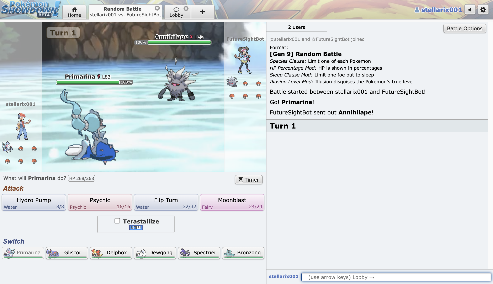
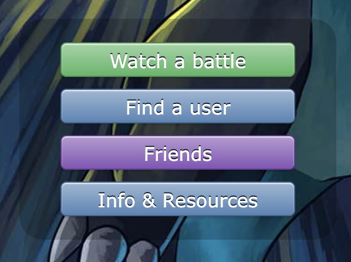
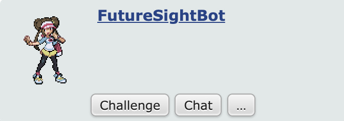
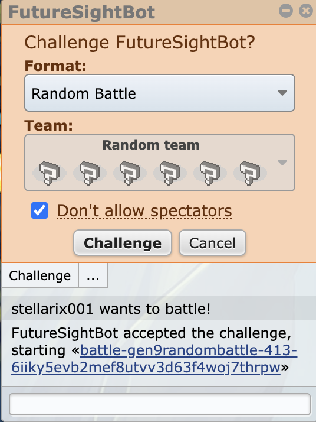

# FutureSight

A Gen 9 Random Battle bot for Pokémon Showdown, comparing MCTS and Minimax algorithms. Built for a COP3530 project



## Setup

Requirements: Python 3.11+, Node.js, Rust (from https://rustup.rs).

1. Clone Pokémon Showdown next to this repo (not inside it) and start it:

   ```
   git clone https://github.com/smogon/pokemon-showdown.git
   cd pokemon-showdown
   npm install
   cp config/config-example.js config/config.js
   node pokemon-showdown start --no-security
   ```

   Leave this terminal open and go to `localhost:8000`.

2. In a second terminal, set up this repo:

   Clone the repo:

   ```
   git clone https://github.com/parkinw-sys/FutureSight.git
   cd FutureSight
   ```

   Create a Python venv:
   <br><br>
   macOS/Linux

   ```
   python3 -m venv .venv
   source .venv/bin/activate
   ```

   Windows (powershell)

   ```
   python -m venv .venv
   .venv\Scripts\Activate.ps1
   ```

   Install Python dependencies:

   ```
   pip install -r requirements.txt
   pip install poke-engine --config-settings="build-args=--features poke-engine/gen9,poke-engine/terastallization --no-default-features"
   ```

3. Check it works:

   ```
   python main.py
   ```

   It should simulate 10 battles between the MCTS and Minimax bots and print the result.
   <br><br>
   To play against either bot yourself, you need to create a Pokémon Showdown account or log in. Then, run either `mc.py` or `minimax.py`. You should see a message like: <br>

   ```
   Waiting for a challenge... challenge FutureSightBot at http://localhost:8000
   ```

   Then, click on "Find a user" and search for FutureSightBot and challenge it.
   
   

   Once you click "challenge", a secondary pop-up appears where you have to click "challenge" again. Enjoy the battle!
   
